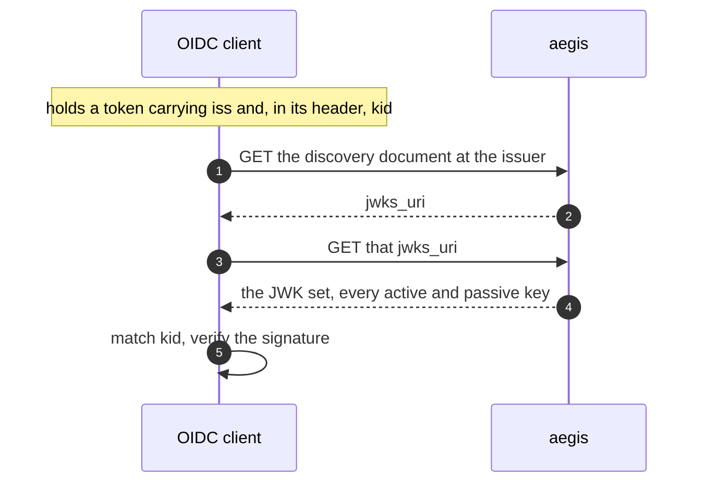
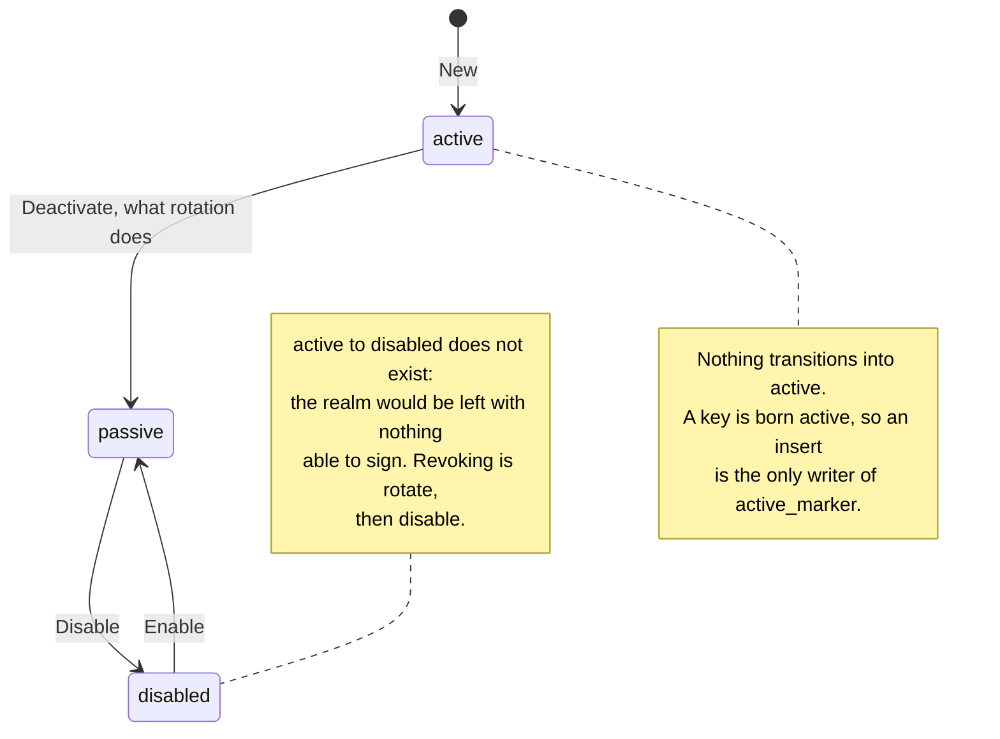
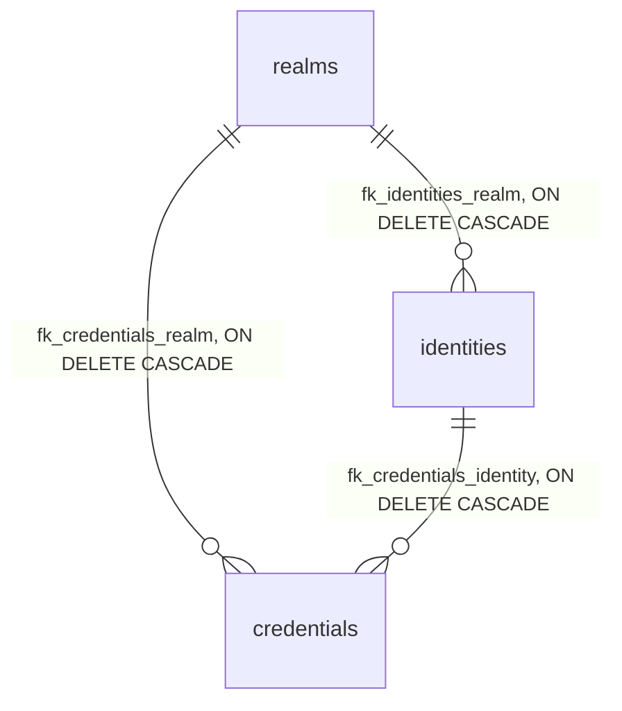
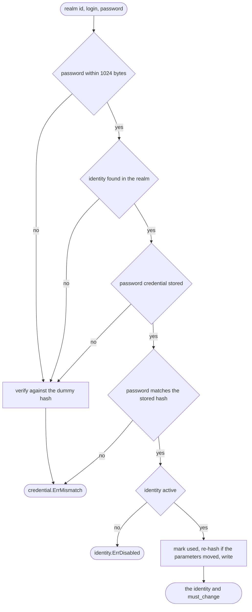
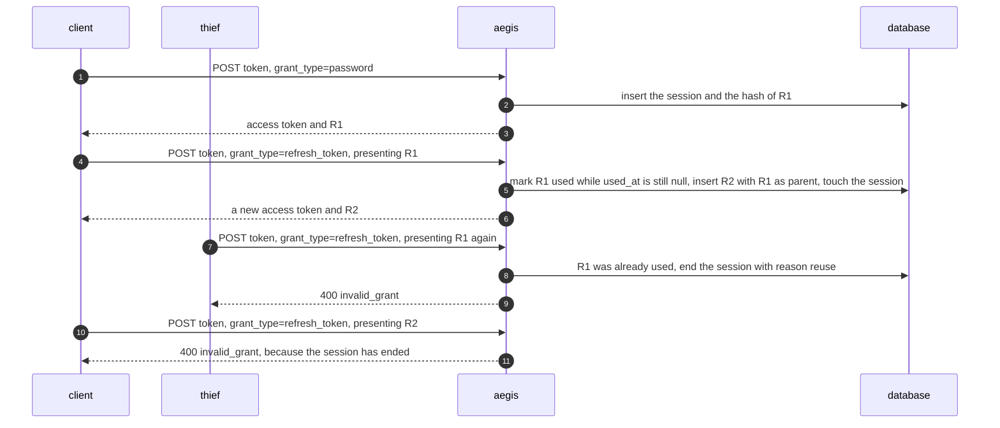
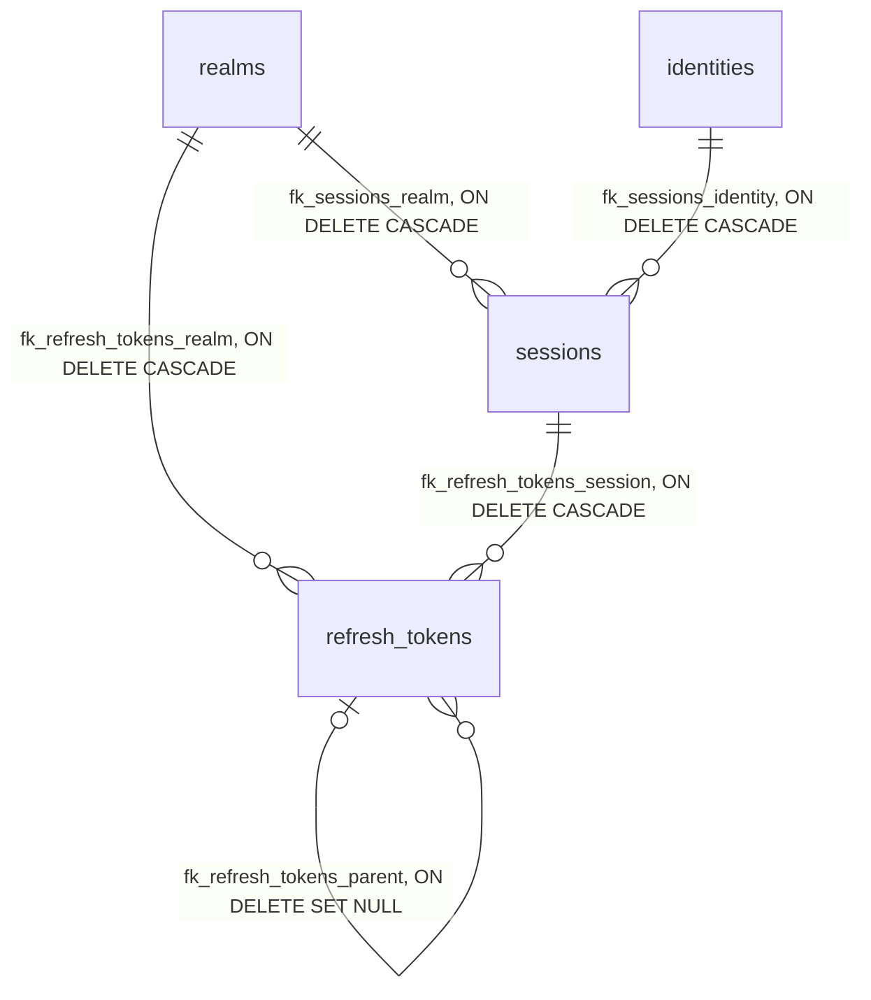
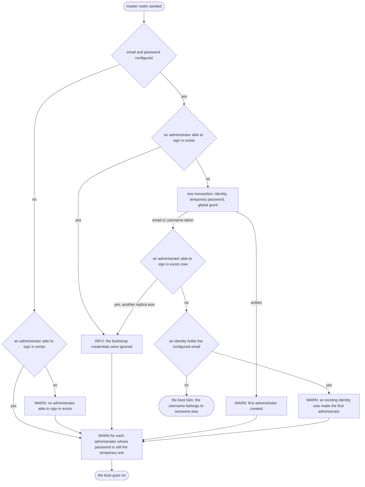
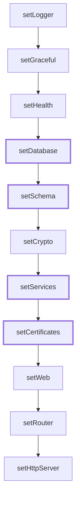
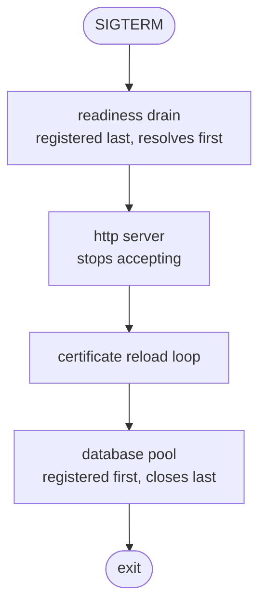
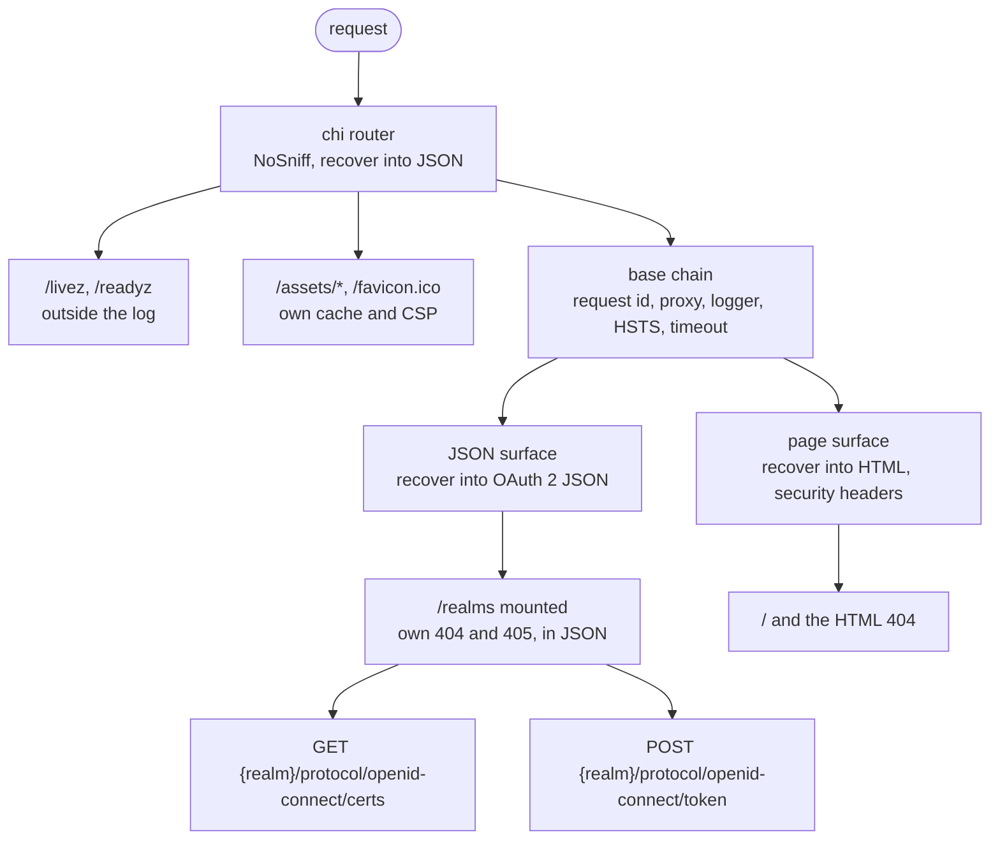

# Architecture

## Layout

```
cmd/aegisd                  entry point: signals and exit code, nothing else
internal/application        assembly and lifecycle
internal/cli                subcommand dispatch for `aegisd migrate`, `aegisd key`, `aegisd identity`, `aegisd session`, `aegisd admin` and their verbs, and for `aegisd bootstrap-admin`
internal/configs            configuration structs, defaults and validation
internal/domain/realm       the realm aggregate and its token and session settings; imports nothing internal
internal/domain/key         the key aggregate; imports nothing internal
internal/domain/identity    the identity aggregate; imports nothing internal
internal/domain/credential  the credential aggregate; imports nothing internal
internal/domain/session     the session and the refresh tokens bound to it; imports nothing internal
internal/domain/token       builds and verifies the access token, a JWT in a compact JWS; standard library only
internal/domain/admin       the administrative grant, who may administer which realm; imports nothing internal
internal/service            the use cases; declares the interfaces they consume
internal/repository         implements the service interfaces over GORM
internal/migrations         the embedded schema SQL, one directory per dialect
internal/handler/page       the handlers for the HTML surface
internal/handler/oidc       the handlers for the protocol surface: the JWKS and the token endpoint
internal/http               server, middleware, response format
internal/http/assets        fingerprints and serves the static files
internal/http/render        composes layouts with pages and writes HTML, over an injected filesystem
internal/infra              logging, graceful shutdown, health, env parsing
internal/infra/sealer       AES-256-GCM over the installation's master key
internal/infra/keygen       key pair generation
internal/infra/passhash     argon2id password hashing, encoded as PHC strings
internal/buildinfo          identity of the running binary
internal/templates          owns the embedded templates and assets; declares two filesystems and no behaviour
test/integration            exercises the compiled binary
```

`internal/templates` declares the two embeds and nothing else: a template and an
asset are deliberately separate filesystems, because a template is executed and
never served raw, an asset is served raw, and one filesystem for both would let
the file server hand out `layouts/base.gohtml` as text.

`internal/handler/page` sits at that depth, not under `internal/http`, on
purpose. `internal/http/*` is mechanism — transport, no business rule, no
dependency on domain or service — while a handler is a layer, where a request
becomes a use case call. Keeping the layers at one level is what makes the
dependency rule readable from the tree. `internal/handler/oidc` is beside it
rather than beneath it for the same reason, and the administration API becomes
a third sibling; what separates them is the audience of the answer, not the
depth of the package.

`internal/infra/sealer` and `internal/infra/keygen` are two packages and not
one, because they have two jobs — one encrypts, the other generates — and
because the single package that would hold both would be called `crypto`, which
collides with the standard library in every file that imports the two together.

## Dependency rule

Dependencies point inward. `internal/http/server`, `internal/http/response`,
`internal/infra/graceful` and `internal/infra/health` import nothing internal:
each declares its own `Options` rather than depending on the configuration
structs, so any of them can be built in a test without assembling the whole
application.

Only `internal/application` knows about everything, because wiring is its job.
It is the composition root: it translates `configs` into each package's options,
decides the middleware chain, and lists the resources in startup order.

The interfaces it depends on are declared there too, in `ports.go` and
`resources.go`, never in the packages that satisfy them. `CertificateSource` is
the current one: `internal/infra/certs` does not know it exists, which is what
leaves room for a KMS or an ACME client to answer handshakes later without
either side being rewritten. Anything reaching the outside world is expected to
arrive the same way.

The router is a chi instance, and it exists only inside `internal/application`.
Handlers are `http.Handler` throughout, so no package outside the assembly knows
which router is in use.

## Domain, service and repository

The realm slice adds three packages below `internal/application`, and the
direction of every import between them is the dependency rule made concrete.
`internal/domain/realm` depends on nothing outside the standard library and
`github.com/google/uuid` — it is the innermost layer, and the realm aggregate
lives there with no notion of persistence or transport. `internal/service`
declares the interfaces its use cases consume, `RealmRepository` and `Store`,
rather than depending on whatever ends up implementing them — the same
reasoning the dependency rule above already applies to `CertificateSource`.
`internal/repository` implements those interfaces and therefore imports
`service` to do it, which points the dependency inward rather than outward:
`Store` could not be declared beside its implementation and still typecheck,
since Go requires an interface method's return type to match exactly, and a
method returning a concrete repository type would not satisfy an interface
declared over the abstract one. `internal/application` is the package that
imports all three, because wiring them together is its job: it builds a
`repository.NewStore` over the GORM handle and hands it to
`service.NewRealmService`.

Inside `internal/service` those interfaces are split by who consumes them, not
gathered in one file. A repository interface sits beside its service —
`RealmRepository` and `RealmQuery` in `realm.go`, `RealmKeyRepository` in
`key.go`, `IdentityRepository` and `IdentityQuery` in `identity.go`,
`CredentialRepository` in `credential.go`, `SessionRepository` and
`RefreshTokenRepository` in `session.go`, `AdminGrantRepository` in `admin.go`
— so one file shows both the use case and the contract it depends on.
`ports.go` keeps only what crosses more than one use case: `Store`, and the
ports reaching outside the process. The split was worth doing before it hurt:
with two aggregates a single file was 111 lines, and identity, credential,
session, refresh token and administrative grant have each added a repository
since.

`Store` stays accessors and `InTx`, nothing else. It is the one interface every
fake in the test suite must implement in full, so a method that did work there
would be paid for in every test that never calls it.

`Realm` carries private fields with accessors and no setter for `id`, `slug`,
`issuer` or `createdAt`, which is what makes the issuer immutable in a way the
compiler enforces rather than a way people have to remember. It has two
constructors for two different origins: `New` is birth — it generates a
UUIDv7, derives the issuer from the realm's slug and the process's public URL,
and validates everything — while `Rehydrate` is the repository's door back in,
and takes the stored issuer as given rather than deriving it. Deriving the
issuer inside `Rehydrate` would recompute every realm's identity from whatever
public URL the reading process happens to hold, which is exactly the drift the
stored `issuer` column exists to prevent: an issuer is derived once, at
creation, and stored, never recomputed on a read.

## Database schema

`internal/migrations` owns the embedded SQL that builds the aegis schema, one
directory per dialect — postgres, mysql, mariadb, sqlite — each covered by its
own `//go:embed` glob and exposed through `For`, which roots the returned tree
at that dialect's directory so the runner sees migration files rather than a
directory of directories. MariaDB has carried its own directory since day one
even though it is byte for byte identical to MySQL today, because splitting it
out later is not possible remotely: an installation that already migrated
carries its lineage in `aegis_schema_migrations`, and there is no way to
retarget that recorded history from where it lives.

That control table is named `aegis_schema_migrations` rather than
golang-migrate's own `schema_migrations` default, because aegis runs on-prem
against a customer's own database and may share it with another application.
If that neighbour also happens to use golang-migrate, a shared table name
would have aegis read someone else's recorded version and apply nothing — with
no error, since golang-migrate has no way to know the version it read was
never its own.

Every migration file holds exactly one statement, and this is forced rather
than merely conventional: the MySQL DSN sets `MultiStatements` to false,
because MySQL and MariaDB have no transactional DDL, so a file carrying two
statements could apply the first and fail the second, leaving a dirty schema
behind. A test enforces the same rule against every dialect, Postgres and
SQLite included, so a violation is caught before it can reach an engine where
it would only fail at the worst time.

A second test, checking that every dialect directory carries the same set of
versions, exists because the per-engine test jobs cannot catch what it
catches: golang-migrate applies whatever it finds in the source and stops
without error, so a version added to three dialect directories and forgotten
in the fourth leaves every job green. The customer running that fourth engine
is the one who discovers it.

`Latest` derives the highest version a dialect carries by reading its
directory rather than from a declared constant, because a constant is one more
thing to forget to bump. An empty directory is an error rather than version
zero, because zero already means "nothing applied yet," and reporting it for a
dialect with no migrations at all would compare the boot's version check
against a lie.

The boot's version check is asymmetric on purpose: a schema older than the
binary is refused, a schema newer than the binary is tolerated. The first half
is what stops a query from reaching a column no migration ever added. The
second half exists for rollback — during a rolling update the previous binary
keeps running beside the new one, which has already migrated the schema
forward, and a binary that refused a version it did not recognise would remove
the ability to roll back exactly when a rollback is needed. A schema recorded
dirty — a prior migration failed and left the state uncertain — is refused
regardless of direction, and recovery is manual: inspect and fix the schema by
hand, then clear the flag with `aegisd migrate force <version>`.

`aegisd migrate` exposes the same subsystem as a subcommand, opening the
database through the same configuration translation the server uses so a
migration never runs under different TLS or pool settings than the process
that will serve traffic. Bare, it applies pending migrations and then verifies
the result the same way boot does. `migrate status` runs no migration at all
and exits 1 when the schema is behind, 2 when it is dirty, which is what makes
it usable as a deployment gate — an init container or a pipeline step that
fails before any replica starts. `migrate force <version>` clears the dirty
flag after a manual repair without touching the schema itself.

## Realm signing keys

An issuer is half of a trust root and a key is the other half. `realm_keys`
carries that half: a row per key, an active RS256 and an active ES256 key per
realm, and the private material encrypted before it ever reaches the database
with a single master key the process reads from the environment.

What a client does with the two halves, and why both have to exist per realm:



Steps 1 and 2 are not served yet: the discovery document is phase 2 of the
roadmap. Steps 3 to 5 are what this slice built. A client that already knows
the `jwks_uri` — because it was configured with one — walks the second half
today, and since the token endpoint landed it has a token to walk it with.

Keycloak does not encrypt it. Realm keys live there in `COMPONENT_CONFIG` as
base64 DER in plain text, and confidentiality is delegated downward to disk and
database encryption — a defensible answer for a product that owns the database
it runs on. aegis runs on-prem, inside a customer's own database and possibly
beside another application, and `SELECT * FROM realm_keys` is the first query
anyone with read access there runs. What the master key introduces is a new way
to lose service: no key, no boot, and no realm able to sign. The bound on that
is the whole argument for accepting it — **losing the master key loses no
data.** Signing keys are regenerable. The recovery is a new pair per realm and
clients refetching the JWKS, at the cost of the tokens already issued being
unverifiable for the minutes left in their lifetime. A short outage, not a
loss.

Each row records the `kek_id` of the key that sealed it, and that id is derived
from the key material — `hex(SHA-256("aegis:kek:v1" ‖ key)[:16])` — never
configured. A label an operator chooses can be left behind: change the material
and keep the name, and every row goes on claiming to be openable by a key that
does not open it, with the discovery arriving at the first signature rather
than at the change. Derived, the id moves whenever the material does, and the
domain prefix keeps the stored value from being a bare hash of the secret.

The associated data binds each ciphertext to `realm_id ‖ kid`, so a row lifted
into another realm's rows does not open — the tenancy boundary held by the
cipher and not only by a `WHERE` clause, in a product whose worst failure is
leakage across exactly that line. It is the `kid` and not the row's `id` for a
mechanical reason: `key.New` generates the `id` and needs the sealed blob to
build the aggregate, while the `kid` derives from the public key and therefore
exists before either of them. It binds just as tightly, being a hash of the very
key being sealed.

The `kid` itself is the RFC 7638 thumbprint of the public key — the canonical
JWK of the required members only, hashed with SHA-256, base64url without
padding, 43 characters. A random identifier would work for keys aegis
generates and stops working at the first key someone imports: the same key
loaded twice would take two identities instead of colliding on
`uq_realm_keys_kid`, and a `kid` in a token could not be checked against a key
recomputed from scratch. The thumbprint and the published JWK are built from
one function in `internal/domain/key`, not two, because two constructions of
the same canonical object are the pair that eventually disagrees — and
disagreeing here means a `kid` that does not identify the key it is attached
to.

"One active key per realm, purpose and algorithm" is naturally a partial unique
index, `WHERE status = 'active'`. Postgres and SQLite have those; MySQL and
MariaDB have neither partial nor filtered indexes, and a functional index over
an expression is not the same thing. So the rule moves into a column:
`active_marker` holds `'y'` on an active row and `NULL` on every other, and a
plain unique index covers it, resting on the one property all four share —
NULLs do not collide in a unique index. `ck_realm_keys_marker` keeps the marker
from lying, forcing `active_marker IS NOT NULL` to hold exactly when the status
is `active`; both sides of that equality are non-nullable expressions, so it
never evaluates to NULL and never passes by accident. The marker has no field
on the aggregate and is derived by the repository, because it is not a fact
about a key — it is the mechanism behind one rule, and a field would let a
caller set it.

The statuses the marker tracks, and the transitions the aggregate refuses:



`Enable` returns a key to passive and never to active, for the same reason:
putting a key back into service is a rotation.

Unlike `realms`, which declares its unique rules as named table constraints,
these are indexes. SQLite has no `ALTER TABLE DROP CONSTRAINT`: changing a
named constraint there means creating a new table, copying the rows, dropping
the old one and renaming — four statements against a table holding live key
material — while a unique index is `DROP INDEX` and `CREATE INDEX` on all four
engines. The rule most likely to change is this exact one, on the day `purpose`
admits `'enc'` or the day the active key stops being per algorithm, so it is
written in the form that can be changed. `realms` is left alone; rewriting it
now buys nothing.

A realm and its keys are written in one transaction, which is what makes a
realm without keys unrepresentable — the same reasoning that made `pending` an
impossible realm status. There is no window in which a realm exists and cannot
sign, so no caller has to handle one. The generation, though, is deliberately
outside that transaction: RSA-2048 costs on the order of hundreds of
milliseconds, and a transaction open across it holds a pooled connection — and
whatever it has already written — for the length of a computation that touches
no row. `KeyService.Prepare` takes no
context and no database for that reason — it generates, seals, and builds the
aggregates — and the caller persists the result inside a transaction it owns.
`RealmService` holds the `*KeyService` rather than a third service being
introduced to call the two in order, which would be a layer for a three-step
sequence.

The JWKS is served at `/realms/{slug}/protocol/openid-connect/certs`, which is
Keycloak's path exactly. No specification requires any particular one — clients
arrive through `jwks_uri` in the discovery document — so the only argument
available is compatibility with the product customers migrate from, and it is
the one taken. `certs` is a misnomer inherited along with it: what is served is
public keys, and aegis issues no certificates for them. The media type does not
follow the same argument: it is `application/jwk-set+json`, the one RFC 7517
registers, where Keycloak answers `application/json`. Every client library
parses the body without inspecting the type, so compatibility buys nothing here
and there is nothing to trade against being correct. The document is ordered by
`id` descending rather than by `created_at`, because the ETag is hashed over
the rendered bytes and `created_at` gives no deterministic order: on SQLite it
is `TEXT` written as RFC 3339 with trailing zeros trimmed, where `…:00Z` and
`…:00.5Z` sort by comparing `Z` against `.` and the row without a fractional
part sorts *after* the one that has it. A UUIDv7 in canonical form is
fixed-width hexadecimal with the timestamp in its leading bits, so ordering by
`id` is chronological on the three dialects storing it as text and on Postgres,
which compares `uuid` by byte value.

Every protocol endpoint turns a slug into a realm through
`RealmService.Resolve`, so the status rule lives in one place instead of being
remembered at each one.
An archived realm answers 404: its row exists to keep its slug and issuer
occupied, so that cached discovery and dead tokens cannot follow them to a new
realm, and not to serve anything. A **disabled** realm serves its JWKS
normally, which is the counterintuitive half. Withholding the document revokes
nothing — the tokens already signed stay valid until they expire — and all it
achieves is making "realm disabled" indistinguishable from "key rotated" for
every client holding one. A realm whose keys are all disabled answers `200`
with `{"keys":[]}` rather than 404, for the same distinction: the realm exists,
it has nothing to publish.

`SignerSource` hands back a `crypto.Signer` and the `kid`/`alg` pair a JWS
header carries, rather than the private key. That shape is what lets a KMS
replace the implementation whole instead of a part inside it: a KMS never
returns private material, so "open the seal and parse the PKCS#8" has no
analogue there, while "give me something that can sign for this realm" does —
and `crypto.Signer` is the standard library's own name for signing without
being handed the key. It is the arrangement `CertificateSource` already has,
where what changes is on the far side of the interface and no caller is edited.
The shape leaves one trap for whoever assembles a JWS on top of it:
`ecdsa.PrivateKey.Sign` produces an ASN.1 DER signature, while JWS ES256
requires the fixed-width `R ‖ S` concatenation — 64 bytes for P-256, each half
left-padded. A DER signature in a JWS is accepted by nothing. RS256 has no
equivalent problem, since `rsa.PrivateKey.Sign` with `crypto.SHA256` is already
the PKCS#1 v1.5 signature that `alg` names. `internal/domain/token` is where
the conversion now happens, described under
[Sessions and tokens](#sessions-and-tokens).

There is no signer cache. Opening a seal and parsing a key is cheap next to the
round trip that fetched the row, and a cache would carry a problem of its own,
since a rotation performed on one replica leaves every other one signing with
what it cached. Tokens exist now, and the only requests that sign are a login
and a refresh — a login already pays for an argon2id verification, and a
refresh for several round trips — so there is a consumer, and still no
measurement saying the signer is what it waits on. Until one does, a cache
would be an optimisation bought with a correctness problem.

## Identities and credentials

An identity is who someone is inside one realm; a credential is how that
identity proves it. They are two tables, one to many, and two aggregates —
`internal/domain/identity` and `internal/domain/credential` — rather than a
`password_hash` column on the identity. The column is the shorter road today
and the wrong shape the day a second factor or a federated login arrives: each
is another proof for the same person, and a model with the proof folded into
the person has to be taken apart to admit one. `ck_credentials_type` admits
only `'password'` for now, and `uq_credentials_type` on `(identity_id, type)`
keeps it to one credential per type, so "the password of this identity" is a
single row and never a choice between several.



Uniqueness is per realm and never global: `uq_identities_email` covers
`(realm_id, email)` and `uq_identities_username` covers `(realm_id, username)`,
realm first in both. That is the README's opening promise made into a
constraint — the same address may be two different people in two realms — and
a global unique email would have turned the tenancy boundary into something one
tenant can probe from inside another. Email is required and username is
optional. The optional half rests on the property `active_marker` already
rests on, NULLs not colliding in a unique index on any of the four engines:
the aggregate's "no username" is the empty string, the repository stores it as
`NULL`, and any number of identities without a username coexist in one realm
where two empty strings would not.

Both are normalised in the aggregate, not in SQL. The MySQL and MariaDB tables
are created under `utf8mb4_bin`, so the database compares bytes, and it is the
lowercasing in `identity.New` that makes `Ana@Example.com` and
`ana@example.com` the same row rather than two. Leaving it to a
case-insensitive collation would have meant four engines agreeing on what
"same" means, which they do not. `Rehydrate` refuses a stored value that is not
in normal form instead of repairing it: a lookup by the normalised value would
never have found that row, so quietly fixing it on the way out would hide a row
no login can reach. A username cannot contain `@`, and that is what lets a
login identifier be told apart with no ambiguity — one with an `@` is looked up
as an email, one without as a username, and the two namespaces cannot collide.
Allowing it would have made "which identity did this person mean" a question
with two possible answers.

Every method of `IdentityRepository` takes the realm id and filters on it in
SQL, and so does the credential lookup, so a query that forgets the tenant does
not compile — the alternative is a rule each new call site has to remember, in
a product whose worst failure is leaking across exactly that line. An identity
that exists in another realm is reported as not found, the same answer as one
that does not exist. `credentials` carries its own `realm_id` for that reason,
even though the identity it points at already has one: without it, scoping a
credential query to a tenant would need a join, and a query that left the join
out would still be valid SQL. `ix_credentials_realm` is what keeps the cascade
from `realms` from scanning the table, since no engine but MySQL and MariaDB
indexes a foreign key on its own.

The unique rules here are indexes rather than table constraints, for the
reason the realm keys section gives about SQLite and `DROP CONSTRAINT`; these
are again the rules most likely to change, on the day a credential type admits
more than one row per identity.

`must_change` lives on the credential and not on the identity, because it is
the proof that is compromised or provisional, not the person. On the identity
it would be one flag standing for every credential the identity holds, and an
administrator resetting a password would be marking a passkey as suspect along
with it.

### Passwords

Passwords are hashed with argon2id and stored in the PHC string format, by
`internal/infra/passhash`. The parameters are fixed in code — 64 MiB of memory,
3 passes, parallelism 4, which is the second recommendation of RFC 9106 — and
there is no configuration key for them. What makes that affordable is the PHC
string: it carries the parameters it was produced with, so `Verify` reads them
from the row rather than from the process, and reports a match made under
parameters other than the current ones as needing a re-hash. Raising the cost
later is therefore not a migration; each credential is re-hashed on its next
successful login, while the password is in hand. A configuration key would
have bought the ability to choose weaker parameters per installation and
little else. One hash at these parameters took about 50 ms on the development
machine this was written on, a figure a test logs and does not assert: it is a
measurement of one machine, not a promise about a customer's.

Reading the parameters from the row has a cost of its own. A stored hash is
read back as instructions for how much to compute, and on-prem the customer's
DBA can write to that table, so `Verify` bounds what it will honour — memory up
to 1 GiB, 16 passes, parallelism 64, and a bounded salt and key length — and
refuses anything beyond before deriving a single byte. Without the ceiling, one
edited row would be a way to make a login allocate whatever the row asked for.
A password longer than 1024 bytes is refused for the same kind of reason: it
bounds what one request can hand the hasher, and it is not a strength rule.

Hashing happens outside the transaction, the same rule as key generation and
for the same reason: tens of milliseconds and 64 MiB of computation that
touches no row should not hold a pooled connection while it runs. The
credential is prepared first and persisted inside a transaction the caller
owns, which is also what lets an identity and its password be written together
— an identity that was meant to have a password is never observable without
it.

### Verification

`CredentialService.VerifyPassword` answers one question — is this the password
of that login in this realm — and creates nothing.



An unknown login, an identity with no password and a wrong password are one
error, and each costs one hash computation: where there is no stored hash to
compare against, a dummy is verified instead. Returning early in the first two
cases would answer in a millisecond what a wrong password answers in tens, and
the response time would say which logins exist as plainly as a distinct error
would. The dummy is produced once per process by the same hasher rather than
written into the source, so it always carries the cost real hashes are produced
with and cannot fall behind when the parameters change.

A disabled identity is reported only after the password is proven. Asked
first, the status would tell anyone holding a list of addresses which ones
exist and are disabled; asked last, it is told only to whoever already knows
the password.

A successful verification records `last_used_at`, and the re-hash when one is
due, in a write that applies only while the stored hash is still the one that
was verified. Between the read and that write there is a hash computation, and
a password replaced in that window would otherwise be overwritten by the row
the verification read — the old hash put back over the new one, silently. When
the condition fails the replacement wins and the verification still succeeds:
the password presented was the right one when it was checked.

### What is deliberately not here

No session and no token in the verification itself: proving a password returns
the identity and whether its password must be changed, and what is built on
that answer is `SessionService`, described under
[Sessions and tokens](#sessions-and-tokens). No realm status check either —
`VerifyPassword` takes a realm id, and whether a disabled realm may
authenticate is decided by its caller, `SessionService.Login`, before a
password is looked at. No password policy, beyond refusing the empty string and
the 1024 byte bound. Nothing in these two packages seeds an identity either:
the one identity a boot may create is the first administrator, and only when
the installation was configured with one, as [Administrators](#administrators)
describes.

One limit was stated here before it was met, and it is met now. At 64 MiB per
verification, concurrent logins multiply memory, and nothing bounds how many
run at once. That was harmless while the only caller was an operator at a
terminal. The token endpoint is an HTTP login, so the number of simultaneous
verifications is now chosen by whoever is sending requests, and nothing in
this phase limits it.

### `aegisd identity`

`aegisd identity` is how every identity but the first administrator exists for
now: `create`, `set-password`, `list`, `disable` and `enable`, against a realm
named by its slug, with no server running. It builds its services through the same
constructor the server uses, so a password set from the command line is hashed
with the parameters the server will verify against.

The password never comes from the command line. An argument sits in `ps` for
as long as the process runs and in the shell history for much longer, so it is
read from `AEGIS_IDENTITY_PASSWORD`, or from the file
`AEGIS_IDENTITY_PASSWORD_FILE` names — the same two forms, with the same
refusal to pick a winner when both are set, as the master key. `create` without
either leaves the identity with no credential, unable to authenticate until
`set-password` gives it one. `--temporary` sets `must_change` on the credential:
the password is meant to be good for one login and replaced at it, which is
what an administrator handing out a first password means — though nothing
enforces the replacement yet, as
[Sessions and tokens](#sessions-and-tokens) explains. It describes a password,
so passing it with none supplied is a usage error rather than a flag silently
ignored.

Like every other invocation it needs the master key, though it seals nothing:
configuration is validated whole before the dispatch picks what to run, and no
configuration validates without one. It also needs the realm to exist, and the
`master` realm is seeded by the server's boot, or by `aegisd bootstrap-admin`,
and not by `aegisd migrate` — so against a database that has only been
migrated, it reports that there is no such realm. An archived realm is refused; a disabled one is not, since
disabling a realm is not a reason to stop administering it.

## Sessions and tokens

Proving a password now produces something. A login opens a **session**, a row
on the server, and hands back two tokens: an **access token**, a signed JWT
that lives for minutes and is never looked up in the database, and a **refresh
token**, an opaque secret bound to that session and replaced every time it is
used.

It is the middle road between two simpler designs, and each of those fails
somewhere this one does not. A token that is only a row has to be looked up on
every request by everything that accepts it, which puts the identity provider
and its database on the path of every call in the customer's system. A token
that is only a signature needs no lookup and cannot be taken back: once signed
it is good until it expires, whatever happened to the person since. Splitting
the two jobs keeps what is good in each. Validating an access token stays
offline and cheap — a signature check against the realm's JWKS — and the
refresh is the one request that has to reach the server, so that is where
revocation bites. Ending a session makes its next refresh fail at once and
leaves the access token already out there at most the minutes it had left.
Those minutes are the window in which a revoked session still works, which is
the whole reason the access token is short-lived: its TTL is not a convenience
setting, it is the upper bound on how late a revocation can arrive.



### The session and its two deadlines

A session carries two deadlines, and they are kept differently on purpose. The
absolute one, `expires_at`, is fixed at creation from the realm's
`session_max_ttl` and never moves: however active a session is, it ends there,
so a stolen session cannot be kept alive forever by refreshing it. The idle one
is not a column at all. It is computed at the moment of the check, from
`last_seen_at` and the realm's `session_idle_ttl` as the realm holds it then,
and capped at the absolute deadline. Stored, it would have frozen each session
at the idle TTL in force when it was last used, and a realm that shortened the
value after an incident would have tightened only the sessions opened
afterwards. Computed, shortening it tightens the sessions that already exist,
at their next refresh. Both deadlines are exclusive: at exactly that instant
the session is already expired.

"Seen" means refreshed. Nothing else reaches the server on behalf of a session
— an access token is validated without it — so `last_seen_at` moves only when a
refresh succeeds, and an idle session is one whose client has not refreshed
within the idle TTL.

A session also records the client address and the user agent it was opened
from, and trusts neither for a decision. They are there so that a list of
sessions means something to the person reading it. The user agent is whatever
a client chose to send, so control characters and invalid UTF-8 are removed and
the rest is cut to the column's 255 bytes; an address that does not parse is
recorded as unknown instead of failing the login over a header.

A session that ends keeps its row, with `ended_at` and an `end_reason` of
`revoked`, `reuse` or `realm_disabled`; `ck_sessions_end_reason` admits only
those and `ck_sessions_ended` forces the two columns to be set together.
Ending is a write that applies only while `ended_at` is still `NULL`, so a
session ends once and the first reason is the one that stays.



Both tables carry their own `realm_id` and every repository method filters on
it, for the reason `credentials` does: a session or a token of another realm
is reported as not found, by a query that could not have been written without
the tenant. `ix_sessions_realm`, `ix_sessions_identity`,
`ix_refresh_tokens_realm`, `ix_refresh_tokens_session` and
`ix_refresh_tokens_parent` keep the cascades and the lookups from scanning.

### Refresh tokens

A refresh token is 32 bytes from the system's random source, base64url encoded,
and what is stored is its SHA-256 in `token_hash`, never the token. A copy of
the table therefore yields nothing that can be presented. Plain SHA-256 is the
right function here, where it would be the wrong one for a password: a slow
hash exists to make guessing expensive, and guessing is only a threat to a
secret a person chose. This one is 256 random bits. There is no dictionary to
run against it, and argon2id on every refresh would have bought a slower
endpoint and no security. `uq_refresh_tokens_hash` makes the hash the lookup
key.

There is no refresh TTL. A refresh token expires at its session's idle
deadline as of the moment it was issued, so it cannot outlive the session it
belongs to, and a setting of its own would only have been a second number able
to disagree with the first. The one asymmetry this leaves: the token's expiry
is stored when it is issued, so a realm that later *lengthens* its idle TTL
does not extend tokens already handed out, while one that shortens it still
tightens them through the session check.

**Rotation.** Every refresh consumes the token presented and issues a new one,
whose `parent_id` is the one it replaced — the column records the chain, and
the first token of a session has none. Consuming is a conditional write:
`used_at` is set only while it is still `NULL`. Of two requests presenting the
same token at the same instant, every engine lets exactly one match that row,
and the other finds nothing to update. Reading the token first and writing
afterwards, without the condition, would have let both through with a new token
each.

**Reuse detection.** A token presented after it was consumed is the signal the
rotation exists to produce. Two parties hold the same token, one of them is not
the client it was issued to, and the server cannot tell which. So it does not
try: it ends the session, with the reason `reuse`. That invalidates the whole
chain without walking it, because a token is only as valid as its session —
the newest token, in whoever's hands, dies with it, and the person has to log
in again. The request that loses the conditional write is treated the same way
as one that arrives a minute later: it too presented a token someone else had
just consumed.

The cost is real and there is no grace window softening it. A legitimate client
that retries a refresh it already sent — the response was lost on the way back,
or two tabs fired at once — presents a consumed token and ends its own session.
A window in which a consumed token is still honoured would forgive that client
and, for exactly as long, the thief.

**The reuse check comes before every expiry check.** A token that was consumed
is usually also expired by the time it is replayed, and its session may be
perfectly alive, kept so by the tokens that followed. Checked the other way
round, the replay would be answered as an ordinary expired token, the session
would carry on, and the one signal that a token had leaked would be thrown away
on a technicality.

After the reuse check a refresh is refused when the session has ended, when it
is past either deadline, when the token itself has expired, and when the
identity is no longer active. A disabled identity therefore keeps no session
alive: nothing ends its sessions at the moment it is disabled, and none of them
survives its next refresh.

### Settings per realm

How long things live is the realm's decision, in four typed columns on
`realms`:

| Column | Default | Meaning |
| --- | --- | --- |
| `access_token_ttl` | `300` | seconds an access token is valid |
| `session_idle_ttl` | `1800` | seconds a session survives without a refresh |
| `session_max_ttl` | `36000` | seconds a session lives at most |
| `password_grant` | `false` | whether the password grant is allowed |

They are columns rather than keys in a settings document because a column can
be constrained and defaulted by the schema: `ck_realms_access_token_ttl`,
`ck_realms_session_idle_ttl` and `ck_realms_session_max_ttl` refuse a value
that is not positive, on every engine, whoever wrote it. The rules between
columns live in the aggregate — whole seconds, at most ten years, and neither
the idle TTL nor the access TTL longer than the session's maximum — and
`Rehydrate` enforces them on the way out, since on-prem the customer's DBA can
write to that table. A realm whose row breaks them is an error, not a realm
with surprising lifetimes.

They are not configuration, and nothing changes them yet. The aggregate has no
setter for the TTLs and the repository's update does not write them, so every
realm runs on the defaults until the administration API exists; the only way
to another value today is SQL.

`password_grant` is the one that decides whether a realm can authenticate
anyone at all. Phase 1 has no OAuth clients and no authorization code flow, so
exchanging a username and a password directly at the token endpoint is the only
way in. It is on in the `master` realm, where administration lives, and off in
every other — a realm for a customer's users should not be born accepting
passwords from any caller that can reach the endpoint, with no client to
attribute the request to. A new installation creates `master` with it on, and
a migration turns it on for an installation that already had the row; after
that the boot leaves it alone, like the status, because an operator who turned
it off did so on purpose. Nothing can create or reconfigure another realm yet,
so in practice `master` is the only realm that authenticates today. Turning the
flag off stops new logins and ends nothing: a refresh does not ask it.

### The access token

The access token is a JWT signed with RS256 by the realm's active key. Its
header carries `alg`, the `kid` of that key and `typ` `JWT`; its claims are:

| Claim | Value |
| --- | --- |
| `iss` | the realm's stored issuer, byte for byte |
| `sub` | the identity's id |
| `sid` | the session's id |
| `jti` | an identifier of this token alone |
| `iat`, `exp` | issue and expiry, in whole seconds |

`sub` is the id and never the email. An email is an attribute that changes
and, per realm, can be given to someone else later; a token consumer that keyed
its own records on it would hand one person's data to another. `sid` is what
lets a token be traced to the session that can be revoked. `exp` is the issue
time plus the realm's `access_token_ttl`, and never past the session's absolute
deadline — a session in its last minute issues a token good for that minute,
so no access token outlives the session behind it.

There is no `aud`. An audience names the client or the API a token is meant
for, and there is no client to name until phase 2; a made-up value would be a
claim every consumer learns to ignore. ES256 keys exist per realm and are
published, and nothing signs with them yet.

### A JWS built by hand

`internal/domain/token` builds and verifies the JWS with the standard library
alone, as `internal/domain/key` does the JWK. The format is three base64url
segments and a signature; what a library would add is flexibility — more
algorithms, more header parameters, key resolution from the token — and each
of those is a way JWT verification has gone wrong in practice. Written by hand,
the package supports what aegis issues and refuses everything else.

Most of what verification refuses, it refuses before it looks a key up:

- an `alg` other than RS256 or ES256, so `none` and HS256 never reach a key.
  HS256 is the classic confusion: a verifier that lets the token choose would
  check an HMAC keyed with the RSA *public* key, which everyone has;
- a header carrying `jku`, `jwk`, `x5u` or `x5c`, which invite the verifier to
  fetch or accept a key the token itself supplies, and `crit`, which names
  extensions that must be understood and are not;
- a `typ` that is present and is not `JWT`, and a missing `kid`;
- a JSON object with the same member twice. Unmarshalling keeps the last one
  silently, and another parser may keep the first, so two readers of one token
  could disagree about what it says. The members are walked one at a time
  instead;
- anything that is not three segments of strict, unpadded base64url, or is
  longer than 4096 bytes.

Then the key decides the algorithm, never the token alone. The key the `kid`
resolves to must be of the type `alg` names — an RSA key of at least 2048 bits
for RS256, a P-256 key for ES256 — and a key of the other type is refused
rather than tried. Only after the signature verifies are the claims read:
`iss`, `sub`, `sid` and `jti` must be present, `exp` is exclusive, and an `iat`
or `nbf` more than sixty seconds in the future is refused. The issuer is
returned and not judged, because comparing it with the realm's is the caller's
job and the package knows no realm.

Signing handles the trap the realm keys section left for it. A
`crypto.Signer` over an ECDSA key returns an ASN.1 DER signature, and the
package converts it to the fixed-width `R ‖ S` that ES256 requires, each half
left-padded to 32 bytes; verification accepts exactly 64 bytes and nothing
else.

Nothing in the server verifies an access token yet, because no endpoint accepts
one. The verification exists, and is tested against the tokens the service
issues, so that the first endpoint to take a bearer token does not arrive
together with the code that decides whether to believe it.

### The token endpoint

`POST /realms/{realm}/protocol/openid-connect/token` is Keycloak's path, taken
for the reason the JWKS path was: no specification fixes one, and compatibility
with the product customers migrate from is the only argument on the table. It
takes `grant_type=password` with `username` and `password`, or
`grant_type=refresh_token` with `refresh_token`, and answers `access_token`,
`token_type` `Bearer`, `expires_in`, `refresh_token`, `refresh_expires_in` and
`session_state`, the session's id.

Parameters are read from the body and only from the body, which must be
`application/x-www-form-urlencoded` and at most 16 KiB. A password accepted
from the query string would be a password in every access log between the
client and the process. A parameter sent twice is an error and one sent empty
counts as absent, as RFC 6749 section 3.2 asks. Every response carries
`Cache-Control: no-store` and `Pragma: no-cache`, the refusals included: the
headers are set before anything is decided, so no path can forget them.

Every refusal is a `400` in the OAuth 2 error format:

| Situation | `error` |
| --- | --- |
| wrong content type, unreadable body, repeated or missing parameter | `invalid_request` |
| a grant type other than the two | `unsupported_grant_type` |
| unknown login, wrong password, no password, disabled identity | `invalid_grant` |
| refresh token unknown, consumed, expired, its session ended or expired, or its identity disabled | `invalid_grant` |
| the realm is disabled | `invalid_grant` |
| the realm does not allow the password grant | `unauthorized_client` |

An unknown or archived realm is the `404` every protocol endpoint answers, and
anything unexpected is a `500` with `server_error` and the cause in the log.

Inside a family the failures are indistinguishable, and that is the point of
the table having so few rows. A wrong password and a disabled identity get the
same code and the same description, on top of the equal cost the verification
already pays, so the endpoint does not confirm which logins exist. The six
ways a refresh token can be refused — unknown, already consumed, expired, its
session ended, its session expired, its identity disabled — share one
description too: the difference
between them is exactly what someone holding a stolen token would like to
know, starting with whether the theft was noticed. Two refusals are not
disguised. A disabled realm and a realm without the password grant say so,
before any credential is examined, because they describe the realm and not an
account, and a client integrator has to be able to tell a misconfiguration from
a wrong password. A disabled realm is `invalid_grant` because, of the codes RFC
6749 section 5.2 offers, it is the only one about the grant not being
honoured; the others blame the request or the client.

What reaches the log follows the same care. A credential or a token is never
logged, in any form — not the password, not a refresh token, not its hash. A
refused login logs the realm and the client address at `INFO` and **not the
username**: what gets typed into a login field by mistake is, often enough, the
password, and a log of failed usernames is a log of passwords in the wrong
box. A refused refresh logs the same two fields at `INFO`. Reuse is the
exception in level, a `WARN` reading `refresh token reuse detected`, because it
is the one refusal that says something may have been stolen and an operator
should be able to alert on it.

### Disabled realms, disabled identities, temporary passwords

A disabled realm issues nothing, refresh included. Its live sessions are ended
in the same transaction that changes its status, with the reason
`realm_disabled`, and they do not come back when the realm is enabled again:
re-enabling restores the ability to log in, not the logins that existed.
Leaving them suspended instead would have made re-enabling a realm quietly
resurrect sessions nobody could see in the meantime. Archiving goes through
the same path. What a disabled realm keeps doing is serve its JWKS, for the
reason given under [Realm signing keys](#realm-signing-keys): the access tokens
already signed stay valid for their remaining minutes either way, and
withholding the keys would only make that look like a rotation.

That end of sessions belongs to `RealmService.SetStatus`. No command or
endpoint calls it yet, and a status changed directly in SQL stops issuance —
every login and refresh checks the status — without ending anything.

`must_change` does not stop a login in this phase. A password marked for
replacement still gets tokens, and the endpoint logs a `WARN` with the realm
and the session. Refusing would have been the stricter reading, and it would
have locked out every identity created with `--temporary`, and the first
administrator with them, since there is no change-password flow to send them
through yet. Until one exists,
`aegisd identity set-password` is what clears the flag.

### What is deliberately not here

No logout and no revocation endpoint: ending a session is `SessionService` and
the `aegisd session` subcommand, and nothing a client can call. No
introspection, so a resource server cannot ask whether a session behind an
access token is still alive; it has the signature and `exp`. No discovery
document. No purge: ended and expired sessions and their consumed tokens stay
in the tables and accumulate until a later slice removes them. No query reads
`ix_sessions_expires` yet; it indexes the column such a purge would select on.

No rate limiting and no brute-force protection on the endpoint. Each password
attempt costs the server an argon2id verification and 64 MiB while it runs,
and nothing bounds how many run at once or how many one caller may make. Until
phase 4 of the roadmap, that protection belongs to whatever sits in front of
the service.

Changing a password does not end the identity's sessions. Someone who resets a
password because it leaked has to revoke the sessions too, with
`aegisd session revoke-all`.

One race is left open. A login reads the realm's status at the start of the
request, spends tens of milliseconds verifying the password, and inserts its
session without reading the realm again. A realm disabled inside that window
ends the sessions that exist at that moment, and the login's session is
inserted after it, live, in a disabled realm. It is inert there, since every
refresh checks the status — but if the realm is enabled again before that
session's idle deadline, it is usable, which is the one case where a session
outlives a disable. Its access token is valid for its few minutes regardless,
like any other issued just before.

### `aegisd session`

`aegisd session` is the revocation surface for now: `list` and `revoke-all`
take a realm and a login, `revoke` takes a realm and a session id, and all
three run with no server, through the same service the token endpoint uses.
`list` prints an identity's sessions newest first, ended ones included, with
each one's state — `live`, `expired`, or `ended:` and the reason — computed
against the realm's idle TTL at the moment of asking, the way a refresh would
judge it. `revoke` ends one session and reports an error for one that had
already ended, since "revoked" would be a lie about a session that ended for
reuse an hour earlier. `revoke-all` ends every live session of the identity
and says how many.

The session id `revoke` takes is the `session_state` of the token response and
the `sid` of the access token, so a token in hand is enough to find the session
to end. It is parsed before the database is opened: a mistyped id is a usage
error, not a connection and a lookup.

Revoking ends the refresh and nothing else. The access token already issued
stays valid until its `exp`, which is the trade described at the top of this
section, seen from the operator's chair.

## Administrators

Everything above can authenticate someone, and none of it says who that someone
has to be on a new installation. The first administrator is a circular problem:
an administration API guarded by an administrator's token cannot be what
creates the first administrator, and a console cannot be what creates the
account needed to open the console. So the first administrator never goes
through an interface. It is created by the process itself, at boot, from
credentials the operator injected — and what makes it an administrator is a row
in `admin_grants`, which is the whole of the administrative scope for now.

### Injected credentials, not a generated token

The familiar alternative is the one Jenkins made a habit: the server generates
a one-time secret on its first boot, writes it to a file, and the operator
reads the file to finish the setup. It does not survive the way aegis is
deployed. The production image is distroless and the base manifests mount the
root filesystem read-only, so the file would need an `emptyDir`, and an
`emptyDir` dies with the pod: a restart before anyone read it would leave a
token valid in the database and unreadable forever. With several replicas it is
worse, because the operator has no way to know which pod wrote it.

Injecting the credentials instead removes the machinery along with the problem.
There is no token table, no hash of the token, no TTL, no "only one pending
token" rule, no race between replicas over who issues it and no route that
consumes it. What is left is two values the operator already knows how to
deliver, because the database password and the master key arrive the same way.

The email and an optional username may come from the `bootstrap.admin` section
of the configuration file or from `AEGIS_BOOTSTRAP_ADMIN_EMAIL` and
`AEGIS_BOOTSTRAP_ADMIN_USERNAME`. **The password comes only from the
environment** — `AEGIS_BOOTSTRAP_ADMIN_PASSWORD`, or
`AEGIS_BOOTSTRAP_ADMIN_PASSWORD_FILE` naming a mounted file — and never from
YAML, by the rule and for the reason the database password and the master key
follow: a secret that can live in a configuration file eventually does, and
that file eventually gets committed. A `password` key under `bootstrap.admin`
is an unknown key and fails the boot. Of the two forms the file is the better
one wherever a secret can be mounted: its value is not in
`/proc/<pid>/environ`, is not shown by `kubectl describe`, and is not inherited
by a subprocess. Setting both fails the boot, as it does for every other
secret.

### What the boot decides



The bootstrap is idempotent, and it acts in exactly one situation: the master
realm has no administrator able to sign in. That phrase is one query, and it is
worth reading literally. An administrator able to sign in is an identity of the
master realm whose status is `active`, that holds a global grant, and that has
a password credential. All three, on one identity. A disabled administrator
does not count, nor does a global grant on an identity with no password, nor
does any number of grants that name a single realm. Whether the password is
still the temporary one does not enter into it.

Outside that one situation the configured values are ignored, even when they
differ from what is stored: past the shape check every configuration value
gets, the service does not look at them, and it hashes nothing. **This is not a
password reset channel.** The distinction matters because the opposite reading
is the natural one: an operator who sees a password in a Secret assumes that
editing the Secret changes the password. Keycloak's bootstrap variables created
exactly that confusion. Reading the variable as "the administrator's
password" rather than "the password the first administrator was born with"
would also make it a standing back door: anyone able to edit one Secret and
restart one pod would own the installation. So the boot says what it did
instead of leaving it to be inferred — an `INFO` reading `an administrator
already exists; the bootstrap credentials were ignored and can be removed from
the environment`.

The definition has one consequence that is easy to miss. Disable the only
administrator while the bootstrap credentials are still configured, and the
next boot finds no administrator able to sign in and acts: it re-enables that
identity if the configured email is its own, and creates a second
administrator if it is not. The credentials are meant to be removed once they
have done their job, and this is the practical reason.

With nothing configured the boot creates nothing, and asks the same question
without acting on the answer. When it is no, it logs a `WARN` — `no
administrator able to sign in exists`, followed by the variables to set and the
command to run — so an installation nobody can administer says so on every
boot. It is one condition in both places on purpose: a warning decided by a
looser rule than the bootstrap would stay silent in exactly the cases the
bootstrap would have acted on.

### The temporary administrator

The credential is born with `must_change` set. The password that seeded it came
from a Secret, and the Secret outlasts the moment it was needed for: it stays
in etcd, in the cluster's backups and, often enough, in the GitOps repository
it was applied from. A password with that many copies is provisional by
construction, whatever its strength.

That is also why a weak password is accepted on purpose. The bootstrap section
has no strength rule — a missing password and one longer than 1024 bytes are
the only ones refused. Refusing to boot over `admin123` leaves an installation
with no administrator at all; accepting it and demanding its replacement leaves
one with an administrator and a warning, which is the better of the two.

The warning is the part that carries the weight, so it does not depend on the
bootstrap having run. On **every** boot, whether or not credentials are
configured, the process lists the holders of any grant whose password is still
marked for replacement and logs a `WARN` for each, with the email:
`this administrator's password is still the temporary one`, followed by the
command that replaces it. It stops on the first boot after the password was
replaced, and not before.

Phase 1 does not enforce the change, and that should be read as plainly as it
is written. There is no change-password flow, so `must_change` cannot stop a
login without locking the administrator out — the token endpoint issues tokens
for a temporary password and logs a `WARN`, as
[Sessions and tokens](#disabled-realms-disabled-identities-temporary-passwords)
describes. The flag is reported and logged, nothing more.
`aegisd identity set-password master <email>`, run without `--temporary`, is
what clears it.

### Replicas and the two edge paths

Nothing locks the bootstrap. Two replicas starting against an empty database
both find no administrator and both try to create one; the identity, its
password and its grant are written in one transaction, the unique indexes on
`identities` reject the second, and that transaction leaves nothing behind. The replica
that lost asks the question again, finds the administrator the other one
created, and adopts it — the way the master realm seed and the key seed already
settle their own races. An administrator is never observable half made, and a
lost race is not a failed boot.

When the insert collides and there is *still* no administrator able to sign in,
it was not a race, and the two unique indexes say two different things.

**The email is held by an identity that cannot administer** — one created
earlier with `aegisd identity create`, or an administrator that was disabled or
never had a password. It is completed in place: made active, given the
configured password as a temporary one, given the global grant if it lacks it,
and its live sessions are ended. Refusing instead would fail this boot and
every one after it, for as long as the configuration stood. The log says so at
`WARN`, since an existing account just changed hands.

**The username is held by someone else**, and no identity has the email. The
boot fails with the collision. The email is what says who the administrator is;
a username is a second name for that person, and quietly creating the
administrator without it, or taking it from its owner, would both be guesses.
Changing or dropping the configured username is the fix.

### Reset is explicit and offline

Since the boot will not reset a password, something else has to — an
installation whose only administrator forgot the password, was disabled, or
lost the grant must have a way back in that is not SQL. It is a command, run
on purpose by someone who can already reach the database and holds the master
key: `aegisd bootstrap-admin`.

It reads the same bootstrap configuration the server does, and where the boot
asks whether anything needs doing, it does not ask. The identity holding the
configured email becomes a global administrator with the configured password,
marked temporary: it is made active if it was disabled, the password replaces
whatever was there, and the global grant is added if missing. An email nobody
holds creates the administrator, exactly as the boot would. On an identity
that already exists the configured username is ignored.

The reset also ends every live session of that identity, with the reason
`revoked`. A reset happens because control of the account is in doubt, and
whoever held the previous password may still hold a session; a new password
that left their refresh token working would have fixed nothing. As with any
revocation, an access token already issued lasts until its `exp`.

### The administrative scope

A grant says that an identity may administer, and what. It is either
**global** — every realm, including the ones that do not exist yet — or it
names **one** realm. An identity may hold the global grant and any number of
targeted ones.

Holders are identities of the `master` realm, always. That does not make the
master a parent of the other realms: it is an ordinary realm, with its own
issuer and keys and the same isolation as any other, that happens to be where
the people who run the installation have their accounts. The alternative is a
realm hierarchy, and a hierarchy is a second tenancy model layered over the
first, with its own questions about what a parent may see in a child. A grant
that points from an identity in one realm at another realm answers the only
question there is — may this identity administer that realm — without
introducing a relationship between the realms themselves. An identity of any
other realm cannot be granted anything: the lookup is scoped to the master, so
it is reported as not found, the same answer as one that does not exist.

This is deliberately the smallest thing that can answer that question, and it
is not the authorization model. There are no roles in it, no groups, and
nothing finer than "administers this realm". Phase 3 of the roadmap builds
roles, and when it does this becomes a particular case of them: a global grant
is a role held over every realm, a targeted one a role held over one. It is
its own table now so that phase 1 can have an administrator without designing
phase 3 first.

**The table.** `admin_grants` carries `realm_id`, the realm the holder lives
in, which the service only ever sets to the master's; `identity_id`; and two
nullable columns, `target_realm_id` and `global_marker`. "At most one global
grant per identity" is the same kind of rule as "one active key per realm", and
it gets the same device, the one
[Realm signing keys](#realm-signing-keys) describes for
`realm_keys.active_marker`: a marker column that holds `'y'` on a global grant
and `NULL` on every other, under a plain unique index,
`uq_admin_grants_global` on `(identity_id, global_marker)`. The natural form is
a partial index, MySQL and MariaDB have none, and NULLs not colliding in a
unique index is the property all four engines share. `uq_admin_grants_target`
on `(identity_id, target_realm_id)` does the same for targeted grants, and the
two indexes stay out of each other's way for that same reason: a global grant
is `NULL` in the column the second one covers, and a targeted grant is `NULL`
in the column the first one covers.

`ck_admin_grants_scope` is what makes a grant global or targeted and never
both, or neither: it requires `target_realm_id IS NULL` to hold exactly when
`global_marker IS NOT NULL`. Both sides are non-nullable expressions, so the
check cannot evaluate to NULL and pass by accident — the argument
`ck_realm_keys_marker` rests on. `ck_admin_grants_marker` keeps the marker to
`'y'`. As with the key marker, the aggregate has no such field: a `Grant` has a
target that may be empty, and the repository derives the marker from it.

All three foreign keys cascade — `fk_admin_grants_realm`,
`fk_admin_grants_identity` and `fk_admin_grants_target` — so a grant does not
outlive its holder or the realm it names. `ix_admin_grants_realm` and
`ix_admin_grants_target` keep those cascades from scanning, for the reason
`ix_credentials_realm` exists.

**Authorization.** `AdminService.Authorize` takes an identity and a target
realm and answers yes or no. Every refusal is one error,
`admin.ErrNotAuthorized`: an identity that does not exist in the master realm,
one that is disabled, one with no grant covering the target, and an empty
target are indistinguishable to the caller, so that no endpoint built on it can
leak which rule failed by forwarding what it was told. A disabled administrator
is not authorized, whatever it holds — disabling an identity has to take
administration away at once, without a second step somebody forgets. The check
reads the grants when it is asked. Nothing about administration is written into
an access token, so a grant revoked a second ago is already gone, and there is
no claim left behind to outlive it.

The target's status is not consulted, and neither is its existence.
Administering a disabled realm is how it gets enabled again; a check that
refused it would make disabling a realm a one-way door.

There is no "last administrator" guard. Revoking the only global grant, or
disabling its only holder, is allowed. A guard would protect against a mistake
that is one command from being undone: `aegisd bootstrap-admin` is the way back
in, and it works whatever state the grants were left in.

### What is deliberately not here

No administration API and no console. Nothing in the server calls `Authorize`,
and nothing verifies an access token — the two exist, tested, as the pieces
those surfaces will be built on, for the reason token verification was written
before any endpoint accepted a token. Until then an administrator is someone
who can sign in at the token endpoint and hold a grant, and every act of
administration is still a subcommand run by someone with access to the
database.

No roles, no groups and no permission finer than "administers this realm"; a
realm administrator and a global one differ in reach and in nothing else. No
flow that forces the temporary password to be changed. No guard on the last
administrator. And nothing ends an identity's sessions when a grant is revoked:
there is nothing for them to lose, since no endpoint grants a session anything
on account of it.

### `aegisd bootstrap-admin`

`aegisd bootstrap-admin` is the reset described above, and takes no arguments:
who the administrator is and what its password becomes are the bootstrap
configuration, read the way the server reads it. Without an email and a
password configured it does nothing and says which variables to set.

It needs no server and no server to have ever run. The master realm is normally
seeded by the first boot, and a command that depended on it would be useless
for the one installation that most needs it — one being prepared before
anything serves — so it seeds the master realm and its keys itself, through the
same call the boot makes and under the same issuer rule. It does not migrate:
the schema has to be current, by `aegisd migrate` or by an earlier boot. That
makes "migrate, then bootstrap, then start the replicas" a valid order, with no
bootstrap credentials in the server's environment at all.

### `aegisd admin`

`aegisd admin` operates the grants: `list`, `grant` and `revoke`, with no
server running. `grant` and `revoke` take a login — an email or a username,
looked up in the master realm, the only one whose identities administer — and
optionally a realm's slug. Without the slug the grant is the global one.
`list` prints the grants oldest first, 500 at most, each with its holder's
email, username and status and a scope that is `global` or the realm's slug.

The realm is looked up without the status rule the protocol endpoints apply,
so a disabled or archived realm can be named: the grant has to be there before
the realm is brought back, not after. Granting what is already held and
revoking what is not are errors, not silent successes, so a mistyped realm does
not pass for a completed change. Neither verb touches the identity, its
password or its sessions.

## Startup

`main` parses nothing and holds the single exit point. Everything else lives in
`run`, so deferred calls still happen — `os.Exit`, which a fatal log ends up
calling, skips them.

`application.New` walks a list of steps and can fail. `setDatabase` is the
first one that actually does: it is the first step reaching the outside
world, opening the pool and registering the readiness check before anything
later in the list can run. Every step shares its `error` return because of
this one — the signature was there in anticipation, so a dependency reaching
the outside world did not force the assembly to be rewritten, and a connection
failure surfaces as an error instead of a panic inside a constructor.

The list now reads `setLogger`, `setGraceful`, `setHealth`, `setDatabase`,
`setSchema`, `setCrypto`, `setServices`, `setCertificates`, `setWeb`,
`setRouter`, `setHttpServer`. `setSchema` brings the database up to the version
this binary carries — applying pending migrations only when migration on boot
is enabled — and then verifies the schema version regardless of whether a
migration ran: the check is not conditional on it, because an operator who
forgot `aegisd migrate` with migration on boot disabled would otherwise serve
requests until the first query touched a missing column. `setServices` builds
the store, the key service, the realm service, the identity and credential
services, the session service and the admin service, then seeds the master
realm, and then ensures its first administrator; it is a step of its own,
separate from `setSchema`, because the seed needs services something has to
own — built as locals instead, the admin API would end up constructing a
second set that is not the application's. The session service is built from
the credential service and the key service, which it reaches as a
`SignerSource`: it verifies passwords through the one and signs through the
other, and holds no second path to either. The admin service is built from the
identity and credential services in the same way, so the administrator it
creates is hashed and stored by the code every other identity goes through.
The session service is the one the token endpoint calls, handed to the
protocol handler in `setWeb`. The identity and admin services are reached by
the boot and from the command line, and by no request: no handler holds
either.

The administrator is not a twelfth step. It runs at the end of `setServices`,
after the `master realm ready` line, because it needs exactly what that step
has just produced — the services and a master realm to put the identity in —
and nothing later in the list. It is the only thing the boot seeds beyond the
realm and its keys, and it seeds it only when the installation was configured
with a first administrator and has none able to sign in; otherwise the boot
creates no identity, no credential and no session, in any profile.
[Administrators](#administrators) has the decision in full. A failure there
fails the boot, like the seed before it: a username collision is the one an
operator is likely to meet.



The thick nodes are the steps that reach outside the process, which is what
makes the shared `error` return earn its place. `setCrypto` is not one of them:
it can fail, but only over values the configuration build already resolved.

`setCrypto` sits between them and builds the sealer from the `crypto` section.
It is a step rather than a few lines inside `setServices` because
`setServices` seeds keys and cannot run before a sealer exists. It reaches
nothing outside the process: a `_FILE` secret was already read during the
configuration build, in `envtools.LookupSecret`, and what happens here is a
base64 decode and an AEAD construction over values already in memory. It is where
"no master key, no boot" stops being a validation rule and becomes true of the
process — in every profile, because there is no development fallback. A
constant compiled in would be a decryption key every installation shares, and
would put safety in a guard that refuses it rather than in the secret not
existing. A process holding a *previous* master key logs an `INFO` saying so,
since it means a rewrap is in flight and unfinished.

The seed's time budget changed meaning with it. It borrows
`database.connect_timeout` — ten seconds by default — and that used to cover a
few single-row round trips on an already open connection. On a first boot it
now also covers generating the master realm's two key pairs. RSA-2048 and P-256
fit inside it comfortably, but the borrow is no longer only about round trips,
and anyone tuning `connect_timeout` down should know what else is being cut.

The administrator borrows the same setting and not the same budget: it starts
a deadline of its own, another `connect_timeout`, once the seed has finished.
Sharing one would have had the argon2id hash of a first boot paid out of
whatever generating two key pairs left over, and the first boot is the one
that does both. That deadline covers the bootstrap and the listing of
temporary administrators behind the warning. On every boot but the one that
creates or completes the administrator it is a few round trips, since a
password is hashed only when one is about to be written.

The `master realm ready` line carries the active `kid` per algorithm — active only, because the log encoder appends fields without deduplicating and the passive keys would repeat `kid_RS256` after a rotation, because
that is the first thing anyone looks for when a client reports a signature it
cannot verify.

The seed only ever reads and writes the master realm's issuer, never its
status: an operator who disabled the master realm did so on purpose, and the
boot has no business reversing that. When the stored issuer already matches
what this process derives from its configured public URL, the seed leaves the
realm untouched. When it does not, development and production diverge for
reasons that belong to each: development rewrites the stored issuer, because
its public URL is derived from the listener and changing the port would
otherwise leave a stale issuer with no symptom pointing at the cause;
production refuses to boot instead, because every client validates the issuer
byte for byte, and discovering after the fact that every one of them rejected
the new issuer is worse than not starting.

Keys are seeded under the same restraint, and after the realm is settled rather
than inside creation, because an adopted or reissued master realm reaches that
point without having gone through creation at all. The seed reads the active
keys first and generates only the algorithms that are missing — without the
read, every boot would burn two key generations to discard them — and it never
rotates, never disables and never reconciles a key that already exists. Two
replicas seeding at once resolve the way the realm seed already resolves its
own: migration holds a session lock and the seed does not, so both generate,
both insert, `uq_realm_keys_active` rejects one, and the replica that lost
re-reads and adopts the row that won instead of failing the boot.

## Shutdown

Resources register a shutdown pending with `internal/infra/graceful`. Pendings
resolve in reverse registration order, like `defer`, so registering in startup
order means the HTTP server stops accepting requests before the database closes.

Readiness draining is registered last and therefore resolves first: on `SIGTERM`
`/readyz` starts failing while the server is still accepting connections, giving
the load balancer time to take the instance out of rotation. Only then does the
server stop accepting. The database registers before both — the resources and
the drain pending alike — so it is the last one open: nothing closes it until
the server has drained and stopped accepting, and no in-flight request can be
turned into a connection error by a pool that closed too early.



A pending that fails does not stop the others — the goal is to close as much as
possible before the process dies. A second signal abandons what is left and
exits with a failure status.

## HTTP

The middleware chain, outside in: request id, request logger, panic recovery,
request timeout. Request id comes first so the logger and the recoverer both
carry it; the recoverer sits inside the logger so the 500 it produces appears on
the request line.



The probes are mounted outside that group. The orchestrator polls them every few
seconds per replica, which would bury real traffic in the request log. Assets
are mounted bare alongside them, for the same reason: a stylesheet request is
not a page view. Both still pass through a recoverer, so a panic answers a
status rather than dropping the connection.

Behind that, two groups share the base chain — request id, the forwarding
decision, the request logger, HSTS where enabled, the request timeout — and
diverge only in how each closes it. The API surface recovers into JSON, the
same writer the bare-mounted probes and assets fall back on. The page surface
recovers into HTML and layers the security headers on top of the chain, so an
unhandled panic still renders as a page rather than a JSON object a browser
would show as text.

`/realms` is a mounted mux inside the API group rather than routes registered
inline on it, and the difference is the 404. chi assigns an inline group's
`NotFound` and `MethodNotAllowed` to the parent mux, so a group cannot scope
its own — setting one there would replace the service's for everything, page
surface included. Only `chi.Mount` builds a mux that carries handlers of its
own. Without the mount, a wrong path under `/realms/...` would fall through to
the page surface and answer an HTML 404, and an HTML document is the wrong
reply at a protocol endpoint: it is read by a client library, not by a browser.
The branch was built with its own 404 and 405 in the OAuth 2 error format so
that every protocol endpoint added later would land inside it rather than
recreate the decision, and the token endpoint is the first to do so: it is
registered beside the JWKS, for `POST` only, and a `GET` there is the branch's
405 in JSON without the handler having been written to say so.

The response format comes from the route group, never from the `Accept`
header. Negotiating it on the error path would make the format depend on
something the caller controls — the caller who broke the request being the one
to decide the shape of the answer. The group is fixed at registration, so it
cannot be.

Assets carry their own guarantees instead of the chain above: `nosniff`, a
`Content-Security-Policy: default-src 'none'`, and a `Cache-Control` good for a
year, because the path itself is fingerprinted by the content's hash and changes
the moment the file does. That hash is verified again on every request rather
than merely stripped off the URL, which is what keeps the year-long promise
honest instead of a name for whatever happens to be sitting behind it. The
policy is there for one route in particular: `/favicon.ico` answers
`image/svg+xml`, and an SVG navigated to directly is a document that can execute
script — harmless for an icon committed to this repository, and the wrong
default the day a realm's own logo is served from the same code.

The page surface's CSP carries no `unsafe-inline` and no `unsafe-eval`
anywhere in it, so no template may carry a `<style>` block, a `style=`
attribute, an inline event handler or an inline `<script>`. That constraint
landed with the first page rather than after the console arrived: retrofitting
it later would mean rewriting every template already written under a looser
policy. A test in `internal/templates` walks the embedded `.gohtml` files and
fails on any of the four, so the rule is enforced rather than remembered.

Errors are written in the OAuth 2 format of RFC 6749 section 5.2, which is what
the endpoints of this service speak.

## Health

Liveness and readiness answer different questions. A failing liveness gets the
container killed and restarted; a failing readiness only takes it out of
rotation.

Liveness therefore checks nothing external. A slow database would otherwise fail
every replica at once and have all of them restarted, turning a degradation into
an outage.

Readiness runs the registered checks concurrently, so a probe costs the slowest
check rather than their sum. Each one reports as an object, the same shape in
every profile, so what changes between them is how much is inside it:

```json
{"status":"ready","checks":{"database":{"status":"ok"}}}
```

Outside development that is all of it. The verdict is public because a check
name says which dependency is down and nothing else; what stays in is the
failure itself and anything a check describes — the server, the pool, the
version — since those describe internal topology on an endpoint reachable from
outside. Under the development profile the whole description is rendered, and
that is also where an ordered shutdown is distinguishable: draining runs no
checks at all, so it is the one `not_ready` with nothing in `checks`.

A failure is logged whatever the response shows. The probe is a moment and the
public report may withhold the reason, so the reason is recorded either way.

The detailed variant reports the description in any profile, and exists for the
authenticated administration surface.
